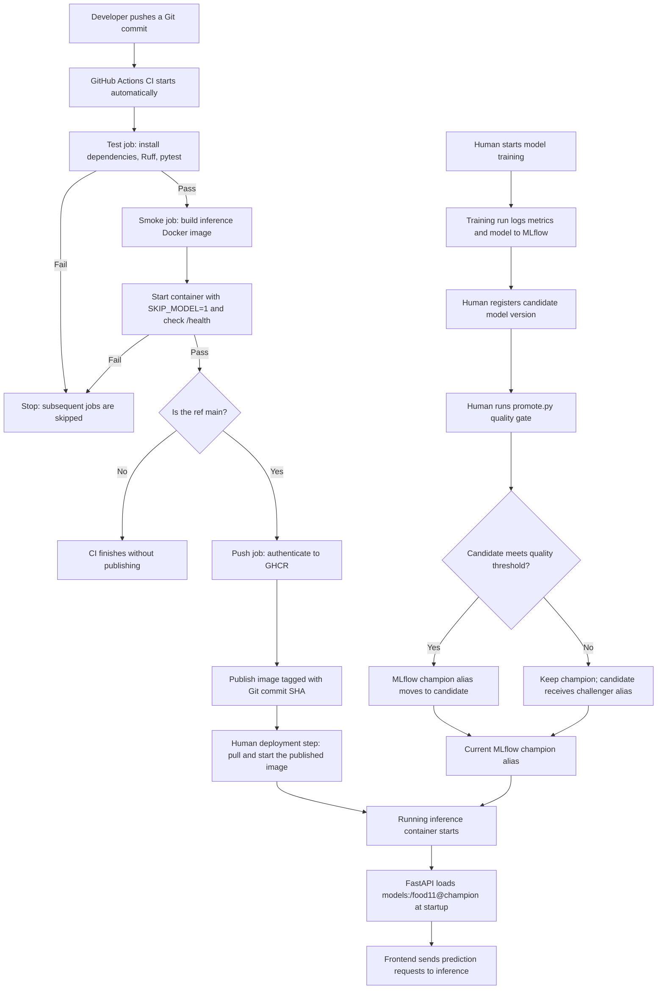

# Lab 5 - CI/CD with GitHub Actions Answers

## Question 1

Unit tests should be fast, isolated, and reproducible. Loading the real registered model would make a test depend on an external MLflow server and large model artifacts rather than just the code under test. A correct implementation could fail if the server is offline or unreachable, the network times out, credentials are missing, or the model alias/artifacts are unavailable. Model loading also makes tests slower and less reliable. The API tests instead set SKIP_MODEL and inject a fake model.

---

## Question 2

The fake-model test proves that the FastAPI prediction endpoint accepts an uploaded image, preprocesses it, calls the model interface, converts the output into a class, and returns valid JSON containing the expected category (Bread) and a confidence between 0 and 1. The health test also verifies that /health returns HTTP 200 without loading the real model.

It does **not** prove that the trained model recognizes food correctly, achieves 90% confidence, loads successfully from MLflow, or generalizes to new images. In this implementation the fake model returns scores that the API passes through softmax, so its input score of 0.90 is **not** necessarily the final JSON confidence.

Local test evidence: **5 passed, 4 warnings in 40.34 seconds**. The four warnings were deprecation warnings, not test failures.

---

## Question 3

The **cross-split duplicate check** caught the intentionally copied image from training/Bread into evaluation/Bread. The validation report showed:

```text
PASS class folders
PASS image format
PASS minimum per class
FAIL cross-split duplicates
PASS class distribution
```

A corrupted image is usually detected immediately because it cannot be opened or processed, so the problem becomes visible. A duplicate shared between training and evaluation is more dangerous because training can continue without any error while evaluation results become artificially optimistic: the model has already seen evaluation content. This is **data leakage** and makes the reported test accuracy less trustworthy.

After removing the intentional duplicate, the dataset validator again passed all five checks.

---

## Question 4

The data validator should run **locally before committing/pushing or starting training**, where the DVC-managed dataset is available. It should also run **in a data-aware training or CI job immediately after retrieving the dataset with DVC and before training or evaluation**. For the second option, the runner would need access to the DVC remote and any required credentials. Our current GitHub Actions workflow runs code tests and the container smoke test without downloading the full dataset; it does not run the data contract there.

---

## Question 5

Because the smoke job declares needs: test, a failing test job prevents smoke from running; smoke is marked skipped. The image-publishing job also cannot proceed because it depends on smoke. Without needs: test, the smoke job could run in parallel and even pass despite failing unit tests, wasting runner resources and making the result misleading.

---

## Question 6

Two successful GitHub Actions runs were compared after pushing an empty commit for the second run.

| Measurement | Run 1 | Run 2 |
|---|---:|---:|
| Total workflow | **1 min 17 s** | **1 min 14 s** |
| Test job | 25 s | 23 s |
| Smoke job | 45 s | 45 s |
| uv sync --frozen | 4 s | 3 s |
| Ruff | 0 s | 0 s |
| pytest | 14 s | 13 s |
| Docker build in smoke | 27 s | 28 s |
| Start container and probe /health | 14 s | 12 s |

The total workflow was **3 seconds faster** on the second run. The clearest dependency-installation improvement was uv sync, from 4 to 3 seconds, consistent with setup-uv reusing cached dependencies. Pytest also improved slightly (14 to 13 seconds). The smoke job stayed at 45 seconds; not every step became faster. Since the difference is small, normal runner timing variation may also have contributed.

---

## Question 7

An image tagged with the Git commit SHA identifies the precise code revision used to build it. This supports traceability, reproducible pulls, and troubleshooting. The latest tag is a moving label, so two machines can run different code if machine A pulls latest before a new image is published and machine B pulls latest afterward. Both may say latest even though their image contents differ.

The pipeline published the image to GitHub Container Registry under **ghcr.io/mathieumoussa-123/mlops-lab-1**, tagged with commit **c9524af7bc37c68d50fecc4a4b649fce6dd4fc05**. The package page displayed this SHA tag, and the corresponding docker pull was performed locally.

---

## Question 8

The push job explicitly grants **contents: read** and **packages: write** because checking out source code requires read access while publishing an image to GHCR requires package write access. GitHub creates a temporary GITHUB_TOKEN for the workflow; no personal GitHub password is stored in the YAML.

Using least-privilege permissions limits the damage if a workflow step is compromised. An unnecessarily powerful token could let an attacker modify repository contents, push malicious changes or releases, or interfere with other resources, depending on its granted scopes. The successful docker/login-action and docker/build-push-action steps confirmed that the scoped credentials were sufficient to publish the image.

---

## Question 9

In pull request **#1, “Break test for branch protection demo”**, the intentionally broken branch caused the required **test** check to fail. The dependent **smoke** check was skipped, and GitHub showed unsuccessful checks with the **Merge pull request** button disabled. After fixing the function and pushing again, both required checks passed, GitHub reported no conflicts, and the merge button became available.

This enforces a shared quality gate for the team: a change cannot be merged into main merely because someone says the tests passed on their own laptop. GitHub runs and records the required checks consistently on the proposed change.

---

## Question 10

The quality gate compares each candidate's test accuracy with the current champion accuracy plus twice the champion's standard error:

\[
SE = \sqrt{\frac{p(1-p)}{n}}
\]

With **p = 0.7545620437956204** and **n = 1096** evaluation images:

- Standard error = **0.012999093380043823** (about **1.30 percentage points**).
- Twice the standard error = **0.025998186760087645** (about **2.60 percentage points**).
- Required candidate accuracy = **0.7805602305557081** (about **78.06%**).

| Model | Registered version | Test accuracy | Quality-gate decision |
|---|---:|---:|---|
| Existing champion | 1 | 0.7545620437956204 | Remains champion |
| peaceful-dog-170 | 2 | 0.145985401459854 | KEPT_AS_CHALLENGER |
| learned-rook-787 | 3 | 0.7545620437956204 | KEPT_AS_CHALLENGER |

Version 2 was far below the threshold, while Version 3 equaled the champion's accuracy but did **not** exceed it by the required 2 × SE. Therefore, neither candidate was promoted. The script saved each decision, both accuracies, the standard error, threshold, test-set size, and compared champion version as MLflow model-version tags.

The final registry verification confirmed **champion → Version 1** and **challenger → Version 3**. Version 2 retained its rejection tags but no longer held the challenger alias because Version 3 received it in the second run.

---

## Question 11

One approach is to run the promotion script on a **self-hosted GitHub Actions runner** installed on the machine or private network that can reach the local MLflow server. A training-completion event or workflow dispatch could trigger the job to run promote.py after the candidate model is registered.

A second approach is to use a **reachable hosted MLflow tracking server**, for example the MLflow service associated with a DagsHub repository, and provide its tracking URI and credentials securely to a GitHub Actions workflow. After training and registering a candidate, the workflow could run promote.py against that server. In either approach, the candidate must be trained and registered first; the promotion gate does not itself train the model.

---

## Question 12



**Automatic steps:** On push or pull request, GitHub Actions installs the project dependencies, runs Ruff and pytest, builds the inference image, and smoke-tests /health with SKIP_MODEL enabled. On main only, after the checks pass, it publishes a container image to GHCR with the Git commit SHA. If the test job fails, the dependent jobs do not run.

**Manual steps in the current implementation:** Training candidate models, registering them in MLflow, running promote.py, and pulling/starting the published image on the target machine. The workflow does **not** automatically deploy the GHCR image or run the model promotion script. The local Compose configuration still builds inference from the project Dockerfile instead of automatically deploying the GHCR image.

**Version selection:** The **code version** is chosen by the Git commit and recorded in the GHCR image SHA tag. The **model version** is chosen through MLflow's champion alias by the promotion quality gate. FastAPI loads models:/food11@champion at startup, so a change to that alias requires restarting the inference service to load the newly selected version.

The required standalone copy of this pipeline diagram is also provided in **lab/lab5.md**.
