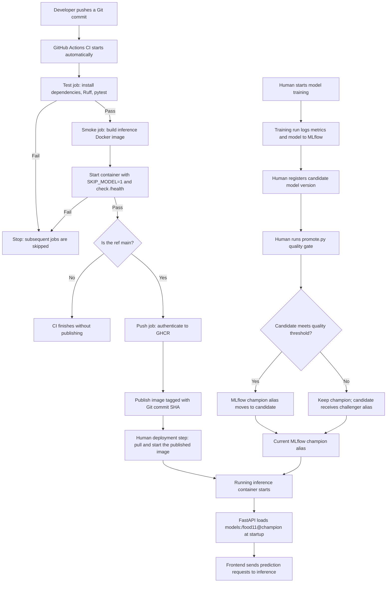

# Lab 5 — CI/CD Pipeline

## Question 12 — Pipeline from Git push to a running container

## Automatic versus manual steps

**Automatic (implemented in GitHub Actions):** On a push or pull request, GitHub runs Ruff and pytest, then builds the Docker inference image and checks its `/health` endpoint without loading the real model. On `main` only, a successful pipeline publishes the image to GitHub Container Registry (GHCR), tagged with the Git commit SHA. A failed `test` job prevents `smoke` and `push` from proceeding.

**Manual (current lab setup):** A person trains the candidate models, registers their versions in MLflow, and runs `promote.py` to apply the quality gate. A person also pulls and starts a published image; the workflow **does not automatically deploy** the GHCR image. The existing Docker Compose setup can start the services locally, but its current `inference` configuration builds from the local Dockerfile rather than automatically using the GHCR image.

## Where versions are decided

- **Code version:** Decided by the Git commit. The `push` job uses the full commit SHA as the GHCR image tag, so a specific image can be identified and pulled reproducibly.
- **Model version:** Decided in MLflow. The `promote.py` quality gate compares a candidate's `test_accuracy` with the current champion plus twice the standard error. It updates the `champion` alias only if the candidate passes; otherwise, it assigns `challenger`. The inference service resolves `models:/food11@champion` when it starts, so an alias change requires restarting inference to load the newly selected model.

**Boundary of automation:** This lab automates testing and image publication, not training, model registration, promotion-script execution, or deployment to a running service.
